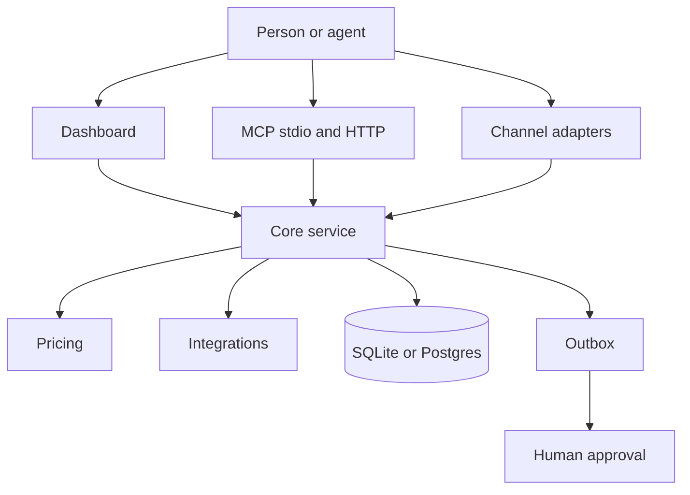

# Sponsor Engine

Open-source front desk and sponsor engine for communities. Chat request in; qualified, priced, sponsor-matched, draft out. A human approves every send.

The mascot is Raft the otter.


The image path is a placeholder. The file is not in this repository yet.

The live demo link is a placeholder: <https://demo.sponsor-engine.example>

## Start in 60 seconds

You need Node.js 20 or later.

```bash
npm install
npm run dev
```

Open `http://localhost:3000`.

Press **Run demo** on the inbox.

Test mode is on. Nothing is sent.

`npm run dev` builds the pricing package when that build is missing.

## Connect your agent

You keep your agent. Sponsor Engine does not replace it.

The same tools run in the dashboard and over MCP. MCP means Model Context Protocol.

| Agent | Guide |
| --- | --- |
| Grok Bot | [docs/connect/grok.md](docs/connect/grok.md) |
| Cursor | [docs/connect/cursor.md](docs/connect/cursor.md) |
| Claude | [docs/connect/claude.md](docs/connect/claude.md) |
| ChatGPT | [docs/connect/chatgpt.md](docs/connect/chatgpt.md) |
| Codex | [docs/connect/codex.md](docs/connect/codex.md) |

The index is [docs/connect](docs/connect/README.md). Channel setup is in [docs/connect/channels.md](docs/connect/channels.md).

Local stdio:

```bash
npm run mcp
```

Local HTTP listens on `http://127.0.0.1:8787/mcp`:

```bash
npm run mcp:http
```

Set `DRY_RUN` to `true` in the client environment. Approve is not a tool. A person approves on the dashboard.

## Bring your own or use ours

A missing key does not stop the process. The built-in tool stays active.

| Area | Built-in default | Optional provider | Env var |
| --- | --- | --- | --- |
| CRM | Local file `crm_export.json` | Zero | `ZERO_API_KEY`, `ZERO_WORKSPACE_ID` |
| Memory | Keyword search over organiser notes | Cognee | `COGNEE_API_KEY`, `COGNEE_URL` |
| Model | Rule-based triage | OpenAI-compatible chat | `LLM_BASE_URL`, `LLM_MODEL`, `LLM_API_KEY` |
| Channels | Dashboard, plus a JSON webhook | WhatsApp, Discord, Telegram, Slack, email | `WHATSAPP_TOKEN`, `DISCORD_BOT_TOKEN`, `TELEGRAM_BOT_TOKEN`, `SLACK_BOT_TOKEN`, `SLACK_SIGNING_SECRET` |
| Data sources | Bundled files in `seed/` | Luma, Meetup, Eventbrite, BuilderBase, MLH, Devpost, GitHub, Hacker News, Companies House | `GITHUB_TOKEN`, `COMPANIES_HOUSE_API_KEY` |

CRM means the sponsor list. An env var is a named value in the process environment.

The model key can be empty. A failed model call keeps the rule-based draft.

`GITHUB_TOKEN` is optional. The unit tests use a fake GitHub response. A live call in this check returned HTTP 403. That row is not live-tested.

Twenty, HubSpot, Notion, Google Sheets, and Mem0 are stubs. A stub stores through the built-in tool. It does not call the network.

The provider list and the status rows are in [packages/integrations/README.md](packages/integrations/README.md).

## Tech stack and integrations

Each table is one layer. Each row names the piece, the built-in default, the optional provider, the env var, and the status.

Status words:

- `live-tested` means a smoke script in this check got a real response from the public service.
- `mock-tested` means a unit test passed a fake HTTP response or a fixture file.
- `unit-tested` means the tests ran the local code. The test called no external service.
- `stub` means the code does not call the network.
- `no test` means the code is in a branch and no test runs it.

The full page is [docs/stack.md](docs/stack.md).

### App

| What | Default | Optional | Env var | Status |
| --- | --- | --- | --- | --- |
| Next.js dashboard | `apps/web` | none | none | no test |
| Tailwind CSS | `apps/web/app/globals.css` | none | none | no test |
| shadcn/ui | `apps/web/components/ui` | none | none | no test |
| Watermelon UI | none in this checkout | shimmer button on the site branch | none | no test |

The site branch copies one Watermelon shimmer button. No test renders it.

### MCP

| What | Default | Optional | Env var | Status |
| --- | --- | --- | --- | --- |
| stdio server | `npm run mcp` | none | `DRY_RUN` | unit-tested |
| streamable HTTP | `npm run mcp:http` and `/api/mcp` | bearer check | `PORT`, `MCP_TOKEN` | unit-tested |

The HTTP test calls the handler in process. It does not open a public port. Approve is not a tool.

### Database

| What | Default | Optional | Env var | Status |
| --- | --- | --- | --- | --- |
| SQLite | `data/sponsor-engine.db` | file path | `SPONSOR_ENGINE_DB` | unit-tested |
| Supabase Postgres | not used | Postgres driver | `DATABASE_URL` | unit-tested |

The Postgres test rewrites SQL placeholders. No test opens a Postgres connection. Do not read that row as live-tested.

### Memory

| What | Default | Optional | Env var | Status |
| --- | --- | --- | --- | --- |
| Keyword search | bundled organiser notes | none | none | unit-tested |
| Cognee | off | Cognee `add`, `cognify`, and `search` | `COGNEE_API_KEY`, `COGNEE_URL` | mock-tested |
| Mem0 | off | none | `MEM0_API_KEY` | stub |

The memory smoke used the built-in search. Cognee had no key, so the smoke did not call Cognee.

### CRM

| What | Default | Optional | Env var | Status |
| --- | --- | --- | --- | --- |
| Local file | `crm_export.json` | none | none | unit-tested |
| Zero | off | companies, contacts, deals, draft notes | `ZERO_API_KEY`, `ZERO_WORKSPACE_ID` | mock-tested |
| Twenty | off | none | `TWENTY_API_URL`, `TWENTY_API_KEY` | stub |
| HubSpot | off | none | `HUBSPOT_ACCESS_TOKEN` | stub |
| Notion | off | none | `NOTION_API_KEY`, `NOTION_SPONSORS_DATABASE_ID` | stub |
| Google Sheets | off | none | `GOOGLE_SHEETS_SPREADSHEET_ID`, `GOOGLE_SHEETS_API_KEY` | stub |

The CRM smoke wrote the built-in file. `emailSent` stayed false. Zero had no key, so the smoke did not call Zero.

### Models

| What | Default | Optional | Env var | Status |
| --- | --- | --- | --- | --- |
| Rule-based triage | on | none | none | unit-tested |
| OpenAI-compatible chat | off | OpenAI, OpenRouter, or Ollama | `LLM_BASE_URL`, `LLM_MODEL`, `LLM_API_KEY` | mock-tested |

The model code is on the channels branch. A missing base URL or model name keeps the rule-based draft. A failed call keeps that draft. The key can be empty. No test called Ollama or OpenAI on the network.

### Pricing model

| What | Default | Optional | Env var | Status |
| --- | --- | --- | --- | --- |
| Gradient boosted trees | scored on the SAMPLE file | none | none | unit-tested |
| Nearest bookings | same SAMPLE file | none | none | unit-tested |

The tests fit both models on fictional rows. The label is SAMPLE. This is not a live venue.

### Channels

| What | Default | Optional | Env var | Status |
| --- | --- | --- | --- | --- |
| JSON webhook | `POST /api/inbound` | none | none | mock-tested |
| WhatsApp export | a `.txt` file, no key | none | none | mock-tested |
| WhatsApp Cloud API | off until a token is set | inbound only | `WHATSAPP_TOKEN` | mock-tested |
| Discord | JSON route with no token | discord.js bot | `DISCORD_BOT_TOKEN` | mock-tested |
| Telegram | webhook parse with no token | bot webhook | `TELEGRAM_BOT_TOKEN` | mock-tested |
| Slack | challenge route with no token | Bolt bot | `SLACK_BOT_TOKEN`, `SLACK_SIGNING_SECRET` | mock-tested |
| Email | `.eml` file or pasted text | none | none | mock-tested |

The channel tests use fixture files. A missing token does not throw. No test sent a message to WhatsApp, Discord, Telegram, or Slack.

### Data sources

| What | Default | Optional | Env var | Status |
| --- | --- | --- | --- | --- |
| Bundled seed | `seed/` when a live call fails | none | `SPONSOR_ENGINE_OFFLINE` | unit-tested |
| Luma event | public event page | none | none | live-tested |
| Luma discover | London discover feed | none | none | live-tested |
| Luma calendar (ICS) | first discover calendar | none | none | live-tested |
| Meetup | London tech events | none | none | live-tested |
| Eventbrite | listing page | none | none | live-tested |
| BuilderBase | public discovery rows | none | none | live-tested |
| MLH | public season events | none | none | live-tested |
| Devpost hackathons | London search | none | none | live-tested |
| Devpost projects | public project search | none | none | live-tested |
| GitHub | public profile | higher rate limit | `GITHUB_TOKEN` | mock-tested |
| Hacker News | public stories | none | none | live-tested |
| Companies House | public company page | official API | `COMPANIES_HOUSE_API_KEY` | live-tested |
| SMS spam model | local naive Bayes file | none | none | unit-tested |

The live rows come from `packages/integrations/scripts/smoke-datakit.ts` and `smoke-live.ts` in this check. GitHub returned HTTP 403 on that run, so GitHub stays mock-tested. The Companies House smoke used the public page, not the official API. The official API path is mock-tested.

### Hosting

| What | Default | Optional | Env var | Status |
| --- | --- | --- | --- | --- |
| Vercel | `apps/web/vercel.json` | Supabase via `DATABASE_URL` | `DEMO_MODE`, `NEXT_PUBLIC_APP_URL`, `DRY_RUN`, `MCP_TOKEN` | no test |

No test deploys the site.

### Docs

| What | Default | Optional | Env var | Status |
| --- | --- | --- | --- | --- |
| Mintlify | this page uses Mintlify frontmatter | none | none | stub |
| Next.js MDX site | none in this checkout | `apps/site` on the site branch | none | no test |

There is no `mint.json` in this repository. Do not treat Mintlify as a running site.

### Cards

| What | Default | Optional | Env var | Status |
| --- | --- | --- | --- | --- |
| `@vercel/og` | none | none | none | stub |

No file imports `@vercel/og`.

## Safe by default

`DRY_RUN` defaults to `true`. Test mode does not send.

`DEMO_MODE=true` forces test mode on a public site.

`ALLOWLIST` is the list of addresses that can be marked sent. It is empty by default.

A draft waits at `awaiting_approval`. A person presses **Approve** on the dashboard.

The row is marked `sent` only when the person approved it, `DRY_RUN` is `false`, and the address is on `ALLOWLIST`.

A sponsor with no public contact uses status `needs_contact`. The recipient stays empty. The tool does not invent an email address.

The write limit is 40 requests from one IP in one minute.

A spam message goes to the spam lane. The lane does not create a task. The check is a local model. The model was trained on public SMS rows. It does not call the network.

The app does not store a guest list. A request stores the message the sender typed. Do not commit personal data.

This repository has no mailer. Read [SECURITY.md](SECURITY.md).

## Accuracy

Two checks are separate. One scores the SAMPLE room prices. One scores sponsor matches. SAMPLE means the rows are fictional. Do not use a SAMPLE price for a real venue.

### Room price

The check is in `packages/pricing`. The command is `npm run evaluate`.

The split sorts bookings by date. The fit uses the first 80 percent of the rows. The score uses the last 20 percent. The SAMPLE score uses 240 rows to fit and 60 rows to score.

MAE means mean absolute error. MAE is the mean of the absolute price errors, in GBP. GBP means pounds sterling.

MAPE means mean absolute percentage error. MAPE uses the 37 paid rows. MAPE skips a price of £0.

The winner is the method with the lower MAE. A constant median is a baseline. The median cannot win.

`npm run evaluate` on the SAMPLE file in this checkout prints these scores. The nearest-booking method wins.

| Method | MAE | MAPE on 37 paid rows | Free slots at £0 | Paid rows at £0 |
| --- | --- | --- | --- | --- |
| Nearest bookings (winner) | £76.92 | 15.9 percent | 22 of 23 | 0 |
| Gradient boosted trees | £96.75 | 13.0 percent | 22 of 23 | 0 |
| Median baseline | £721.83 | 70.6 percent | 0 of 23 | 0 |

Example quotes from that same file, for requests that are not in the history:

| Request | Price | Range |
| --- | --- | --- |
| Community 80-person evening | £0 | £0 to £0 |
| Startup launch | £1,545 | £1,430 to £1,800 |
| Company day for 45 people | £3,745 | £3,545 to £3,935 |

The pricing branch also places each quote on published London rooms of a similar size. That comparable set has 20 evening prices. The low price is £400. The high price is £3,200. The median is £1,350. VAT is not adjusted. Pubs that publish only a minimum spend are not in the set. Somerset House River Terrace and Tobacco Dock Little Gallery are not in the set. The result names three rooms and gives each source URL.

On that calibrated SAMPLE file, company rates sit inside the published band. The gradient boosted model wins. Its MAE is £63.42. Its MAPE is 12.0 percent. The nearest-booking MAE is £67.75. Its MAPE is 16.2 percent. The median baseline MAE is £539.08. Those scores are not the scores of the file in this checkout. Read [packages/pricing/README.md](packages/pricing/README.md) for the file that is here.

### Sponsor match

The check uses 30 labelled London events. Each label has the company, the role, and a source URL. The queried event's own sponsors are held out.

precision@3 is 0.289. That is the mean share of the top 3 names that match a label.

recall@5 is 0.395. That is the mean share of labelled sponsors that appear in the top 5.

The snapshot is `packages/integrations/src/eval/sponsor-match-report.json`. `sponsorMatchEval()` recomputes the scores.

`data/real-data/` holds public events and sponsor claims. Each claim has a source URL. `data/synthetic-data/` is SAMPLE.

## Deploy

The dashboard is a Next.js app in `apps/web`. The database can be SQLite or Supabase Postgres.

Leave `DATABASE_URL` empty to use SQLite at `data/sponsor-engine.db`.

Set `DATABASE_URL` to the Supabase Postgres URL to use Postgres. Use the direct URL on port 5432 for the seed command.

```bash
npm run seed:postgres
```

On Vercel, set the root directory to `apps/web`.

Set the install command to `npm install --prefix ../..`.

Set the build command to `npm run build --prefix ../.. -w @sponsor-engine/pricing && npm run build --prefix ../.. -w @sponsor-engine/integrations && next build`.

Set these env vars on the host. Do not commit the values.

| Env var | Hosted value |
| --- | --- |
| `DATABASE_URL` | Supabase Postgres URL |
| `DEMO_MODE` | `true` |
| `NEXT_PUBLIC_APP_URL` | Public site address, set before the build |
| `DRY_RUN` | `true` |
| `MCP_TOKEN` | Empty on the public demo |
| `ALLOWLIST` | Empty |

Open `/mcp` on the site. The page lists every tool. The remote MCP URL is `/api/mcp`.

Copy `.env.example` to `.env` only when you want to change a local value. Every value in that file is optional.

## Architecture

The dashboard, the MCP server, and the channel adapters call the same core functions. The transports stay thin.



`packages/core` qualifies a request, prices a room, matches sponsors, and writes the outbox.

The sponsor page shows a company size on each match. With no key, the size comes from the public Companies House page. When that page fails, the page uses the bundled note.

Approve stores a CRM draft. The built-in CRM is used when no key is set. Approve does not send email.

Connections reads `getStatus()`. The built-in CRM and the built-in memory are active with no key.

`recall_history` searches with the memory provider. With no key, that search uses the bundled notes.

`packages/pricing` exports `quotePrice`. The currency is GBP.

`packages/integrations` selects the CRM, the memory, and the data sources.

`packages/db` stores the rows. One workspace is one visitor's rows. Shared reference tables stay global.

`packages/mcp` exposes the tools. It does not approve.

Visual rules are in [docs/DESIGN.md](docs/DESIGN.md).

## Roadmap

- Connect WhatsApp, Discord, Telegram, Slack, and email. Each reply stays a draft.
- Show the London market sentence on every quote.
- Add a sender only after approval, with `DRY_RUN` set to `false` and the address on `ALLOWLIST`.
- Leave HubSpot, Notion, Google Sheets, and Mem0 as stubs until a community asks for them.

## Licence

MIT. Copyright 2026 Rohan Kumawat. Read [LICENSE](LICENSE).
