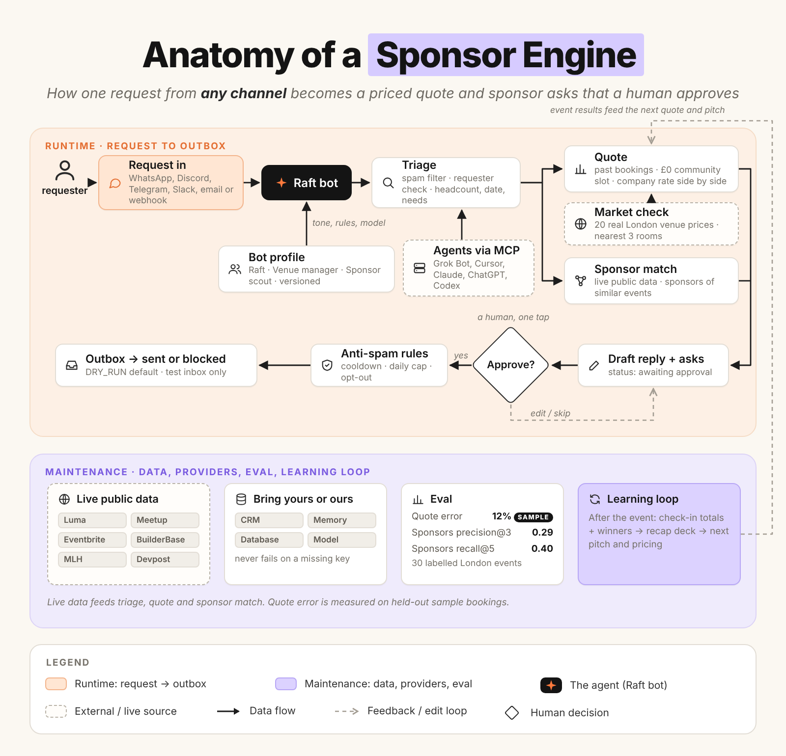
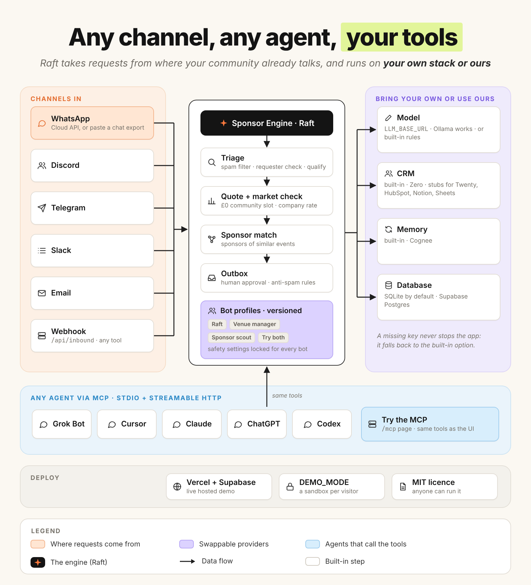
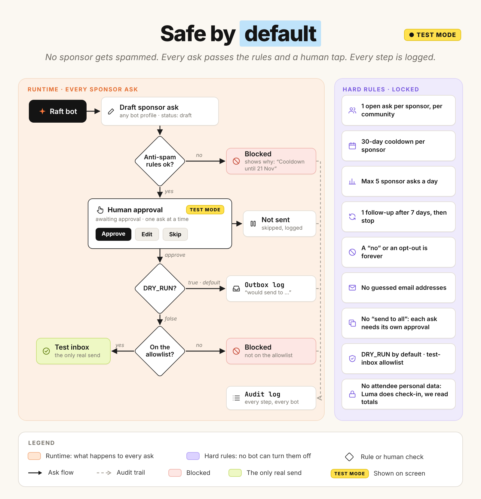
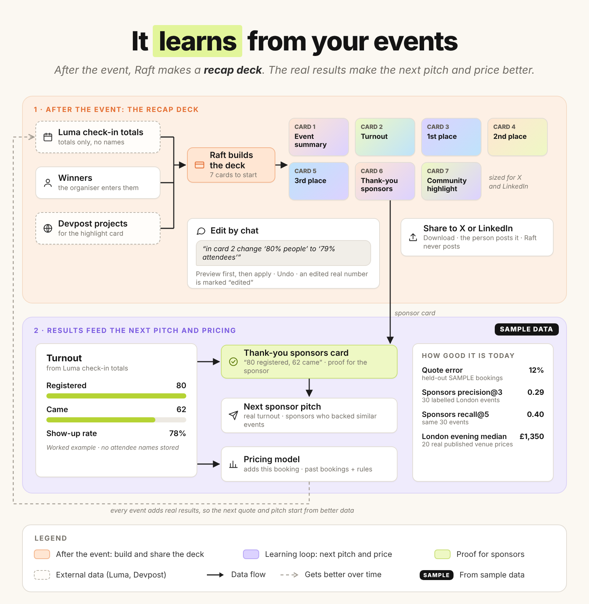
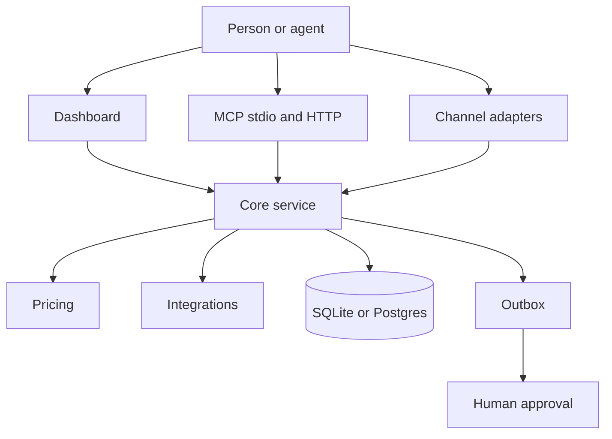

# Raft — Sponsor Engine

**The last software a community manager needs.**

Raft is an open-source helper for people who run communities. Paste a booking request from WhatsApp, email or Slack, and Raft checks it is not spam, gives a fair price for the room and food, finds sponsors and food partners that fit, and writes the emails for you to approve. Nothing is sent without you. It works inside the AI you already use (Grok Bot, Cursor, Claude) through MCP, and runs with no API keys.

## Try it

```bash
git clone https://github.com/rohanChunkbase/sponsor-engine.git
cd sponsor-engine
npm install
npm run dev:web
```

Open <http://localhost:3000> and click **Run the Unicorn Mafia demo**.

Live app: <https://sponsor-engine-app.vercel.app>

MCP URL: `https://sponsor-engine-app.vercel.app/api/mcp`

## Coming soon

These are not built yet.

- Follow-up answers merged into the original request. Today you resend the full message with the date and needs.
- A venue finder for requests that name no venue.
- Advisor mode, which uses your own memory and CRM instead of Raft's storage.
- A persistent hosted database. The live demo resets between server instances.
- Real sending of approved emails. Today it runs in test mode only, and nothing is sent.
- Food partner matching from a curated food-partner list. Today it uses general sponsor data.
- A token required on the hosted MCP. Demo mode is open.
- One-click connect for beginners for each integration.
- A learning loop that feeds event check-in totals into the next quote.



The mascot is Raft the otter.


## Start in 60 seconds

You need Node.js 20 or later.

```bash
npm install
npm run dev
```

Open `http://localhost:3000`.

The first start loads the bundled data. The inbox is empty until a message arrives. Press **Run demo** on the inbox. That reads one WhatsApp note from Unicorn Mafia about a hackathon at Expedite London. Sponsor drafts use placeholders at `sponsors@example.com`. `DRY_RUN` stays on, so nothing is sent. Thames Agent Builders stays in the sample seed. The room price uses SAMPLE venue history. The quote shows the full day (room plus food) next to the published London evening range. A second ask to the same sponsor is blocked, and the reason is on the card.

Test mode is on. Nothing is sent.

`npm run dev` builds the pricing package when that build is missing.

## Connect your agent

You keep your agent. Sponsor Engine does not replace it. Using your own CRM and memory in place of Raft's storage (advisor mode) is not built yet (coming soon).



The same tools run in the dashboard and over MCP. MCP means Model Context Protocol.

| Agent | Guide |
| --- | --- |
| Grok Bot | [docs/connect/grok.md](docs/connect/grok.md) |
| Cursor | [docs/connect/cursor.md](docs/connect/cursor.md) |
| Claude | [docs/connect/claude.md](docs/connect/claude.md) |
| ChatGPT | [docs/connect/chatgpt.md](docs/connect/chatgpt.md) |
| Codex | [docs/connect/codex.md](docs/connect/codex.md) |

The index is [docs/connect](docs/connect/README.md). Channel setup is in [docs/connect/channels.md](docs/connect/channels.md).

Local stdio:

```bash
npm run mcp
```

Local HTTP listens on `http://127.0.0.1:8787/mcp`:

```bash
npm run mcp:http
```

The HTTP server listens on `http://127.0.0.1:8787/mcp`. It uses the same handler as `/api/mcp`. Set `DRY_RUN` to `true` in the client environment. Approve is not a tool. A person approves on the dashboard.

## Bring your own or use ours

A missing key does not stop the process. The built-in tool stays active.

| Area | Built-in default | Optional provider | Env var |
| --- | --- | --- | --- |
| CRM | Local file `crm_export.json` | Zero | `ZERO_API_KEY`, `ZERO_WORKSPACE_ID` |
| Memory | Keyword search over organiser notes | Cognee | `COGNEE_API_KEY`, `COGNEE_URL` |
| Model | Rule-based triage | OpenAI-compatible chat | `LLM_BASE_URL`, `LLM_MODEL`, `LLM_API_KEY` |
| Channels | Dashboard, plus a JSON webhook | WhatsApp, Discord, Telegram, Slack, email | `WHATSAPP_TOKEN`, `DISCORD_BOT_TOKEN`, `TELEGRAM_BOT_TOKEN`, `SLACK_BOT_TOKEN`, `SLACK_SIGNING_SECRET` |
| Data sources | Bundled files in `seed/` | Luma, Meetup, Eventbrite, BuilderBase, MLH, Devpost, GitHub, Hacker News, Companies House | `GITHUB_TOKEN`, `COMPANIES_HOUSE_API_KEY` |

CRM means the sponsor list. An env var is a named value in the process environment.

The model key can be empty. A failed model call keeps the rule-based draft.

`GITHUB_TOKEN` is optional. The unit tests use a fake GitHub response. A live call in this check returned HTTP 403. That row is not live-tested.

Twenty, HubSpot, Notion, Google Sheets, and Mem0 are stubs. A stub stores through the built-in tool. It does not call the network.

The provider list and the status rows are in [packages/integrations/README.md](packages/integrations/README.md).

## Tech stack and integrations

Each table is one layer. Each row names the piece, the built-in default, the optional provider, the env var, and the status.

Status words:

- `live-tested` means a smoke script in this check got a real response from the public service.
- `mock-tested` means a unit test passed a fake HTTP response or a fixture file.
- `unit-tested` means the tests ran the local code. The test called no external service.
- `stub` means the code does not call the network.
- `no test` means the code is in a branch and no test runs it.

The full page is [docs/stack.md](docs/stack.md).

### App

| What | Default | Optional | Env var | Status |
| --- | --- | --- | --- | --- |
| Next.js dashboard | `apps/web` | none | none | no test |
| Tailwind CSS | `apps/web/app/globals.css` | none | none | no test |
| shadcn/ui | `apps/web/components/ui` | none | none | no test |
| Watermelon UI | none in this checkout | shimmer button on the site branch | none | no test |

The site branch copies one Watermelon shimmer button. No test renders it.

### MCP

| What | Default | Optional | Env var | Status |
| --- | --- | --- | --- | --- |
| stdio server | `npm run mcp` | none | `DRY_RUN` | unit-tested |
| streamable HTTP | `npm run mcp:http` and `/api/mcp` | bearer check | `PORT`, `MCP_TOKEN` | unit-tested |

The HTTP test calls the handler in process. It does not open a public port. Approve is not a tool.

### Database

| What | Default | Optional | Env var | Status |
| --- | --- | --- | --- | --- |
| SQLite | `data/sponsor-engine.db` | file path | `SPONSOR_ENGINE_DB` | unit-tested |
| Supabase Postgres | not used | Postgres driver | `DATABASE_URL` | unit-tested |

The Postgres test rewrites SQL placeholders. No test opens a Postgres connection. Do not read that row as live-tested.

### Memory

| What | Default | Optional | Env var | Status |
| --- | --- | --- | --- | --- |
| Keyword search | bundled organiser notes | none | none | unit-tested |
| Cognee | off | Cognee `add`, `cognify`, and `search` | `COGNEE_API_KEY`, `COGNEE_URL` | mock-tested |
| Mem0 | off | none | `MEM0_API_KEY` | stub |

The memory smoke used the built-in search. Cognee had no key, so the smoke did not call Cognee.

### CRM

| What | Default | Optional | Env var | Status |
| --- | --- | --- | --- | --- |
| Local file | `crm_export.json` | none | none | unit-tested |
| Zero | off | companies, contacts, deals, draft notes | `ZERO_API_KEY`, `ZERO_WORKSPACE_ID` | mock-tested |
| Twenty | off | none | `TWENTY_API_URL`, `TWENTY_API_KEY` | stub |
| HubSpot | off | none | `HUBSPOT_ACCESS_TOKEN` | stub |
| Notion | off | none | `NOTION_API_KEY`, `NOTION_SPONSORS_DATABASE_ID` | stub |
| Google Sheets | off | none | `GOOGLE_SHEETS_SPREADSHEET_ID`, `GOOGLE_SHEETS_API_KEY` | stub |

The CRM smoke wrote the built-in file. `emailSent` stayed false. Zero had no key, so the smoke did not call Zero.

### Models

| What | Default | Optional | Env var | Status |
| --- | --- | --- | --- | --- |
| Rule-based triage | on | none | none | unit-tested |
| OpenAI-compatible chat | off | OpenAI, OpenRouter, or Ollama | `LLM_BASE_URL`, `LLM_MODEL`, `LLM_API_KEY` | mock-tested |

The model code is on the channels branch. A missing base URL or model name keeps the rule-based draft. A failed call keeps that draft. The key can be empty. No test called Ollama or OpenAI on the network.

### Pricing model

| What | Default | Optional | Env var | Status |
| --- | --- | --- | --- | --- |
| Gradient boosted trees | scored on the SAMPLE file | none | none | unit-tested |
| Nearest bookings | same SAMPLE file | none | none | unit-tested |

The tests fit both models on fictional rows. The label is SAMPLE. This is not a live venue.

### Channels

| What | Default | Optional | Env var | Status |
| --- | --- | --- | --- | --- |
| JSON webhook | `POST /api/inbound` | none | none | mock-tested |
| WhatsApp export | a `.txt` file, no key | none | none | mock-tested |
| WhatsApp Cloud API | off until a token is set | inbound only | `WHATSAPP_TOKEN` | mock-tested |
| Discord | JSON route with no token | discord.js bot | `DISCORD_BOT_TOKEN` | mock-tested |
| Telegram | webhook parse with no token | bot webhook | `TELEGRAM_BOT_TOKEN` | mock-tested |
| Slack | challenge route with no token | Bolt bot | `SLACK_BOT_TOKEN`, `SLACK_SIGNING_SECRET` | mock-tested |
| Email | `.eml` file or pasted text | none | none | mock-tested |

The channel tests use fixture files. A missing token does not throw. No test sent a message to WhatsApp, Discord, Telegram, or Slack.

### Data sources

| What | Default | Optional | Env var | Status |
| --- | --- | --- | --- | --- |
| Bundled seed | `seed/` when a live call fails | none | `SPONSOR_ENGINE_OFFLINE` | unit-tested |
| Luma event | public event page | none | none | live-tested |
| Luma discover | London discover feed | none | none | live-tested |
| Luma calendar (ICS) | first discover calendar | none | none | live-tested |
| Meetup | London tech events | none | none | live-tested |
| Eventbrite | listing page | none | none | live-tested |
| BuilderBase | public discovery rows | none | none | live-tested |
| MLH | public season events | none | none | live-tested |
| Devpost hackathons | London search | none | none | live-tested |
| Devpost projects | public project search | none | none | live-tested |
| GitHub | public profile | higher rate limit | `GITHUB_TOKEN` | mock-tested |
| Hacker News | public stories | none | none | live-tested |
| Companies House | public company page | official API | `COMPANIES_HOUSE_API_KEY` | live-tested |
| SMS spam model | local naive Bayes file | none | none | unit-tested |

The live rows come from `packages/integrations/scripts/smoke-datakit.ts` and `smoke-live.ts` in this check. GitHub returned HTTP 403 on that run, so GitHub stays mock-tested. The Companies House smoke used the public page, not the official API. The official API path is mock-tested.

### Hosting

| What | Default | Optional | Env var | Status |
| --- | --- | --- | --- | --- |
| Vercel | `apps/web/vercel.json` | Supabase via `DATABASE_URL` | `DEMO_MODE`, `NEXT_PUBLIC_APP_URL`, `DRY_RUN`, `MCP_TOKEN` | no test |

No test deploys the site.

### Docs

| What | Default | Optional | Env var | Status |
| --- | --- | --- | --- | --- |
| Mintlify | `docs/docs.json` and the pages in `docs/` | none | none | the site renders these pages |
| Next.js MDX site | `apps/site` | none | none | unit-tested |

The public site is `apps/site`. It renders the Mintlify pages in `docs/`. A Vercel deploy of `apps/site` needs **Include source files outside of the Root Directory** turned on. The site reads `docs/` and `packages/brand` outside that app folder.

### Cards

| What | Default | Optional | Env var | Status |
| --- | --- | --- | --- | --- |
| `@vercel/og` | none | none | none | stub |

No file imports `@vercel/og`.

## Safe by default



`DRY_RUN` defaults to `true`. Test mode does not send.

`DEMO_MODE=true` forces test mode on a public site.

`ALLOWLIST` is the list of addresses that can be marked sent. It is empty by default.

A draft waits at `awaiting_approval`. A person presses **Approve** on the dashboard.

The row is marked `sent` only when the person approved it, `DRY_RUN` is `false`, and the address is on `ALLOWLIST`.

A sponsor with no public contact uses status `needs_contact`. The recipient stays empty. The tool does not invent an email address.

The write limit is 40 requests from one IP in one minute.

A spam message goes to the spam lane. The lane does not create a task. The check is a local model. The model was trained on public SMS rows. It does not call the network.

The app does not store a guest list. A request stores the message the sender typed. Do not commit personal data.

This repository has no mailer. Read [SECURITY.md](SECURITY.md).

## How it learns

A quote reads past bookings. A sponsor match reads past events. `recall_history` reads the organiser notes.



Feeding the outcome and check-in totals back into the next quote is not automatic yet (coming soon).

A person still approves the draft. The send stays off until the safety gates pass.

The measured scores are in the next section.

## Accuracy

Two checks are separate. One scores the SAMPLE room prices. One scores sponsor matches. SAMPLE means the rows are fictional. Do not use a SAMPLE price for a real venue.

### Room price

The check is in `packages/pricing`. The command is `npm run evaluate`.

The split sorts bookings by date. The fit uses the first 80 percent of the rows. The score uses the last 20 percent. The SAMPLE score uses 240 rows to fit and 60 rows to score.

MAE means mean absolute error. MAE is the mean of the absolute price errors, in GBP. GBP means pounds sterling.

MAPE means mean absolute percentage error. MAPE uses the 37 paid rows. MAPE skips a price of £0.

The winner is the method with the lower MAE. A constant median is a baseline. The median cannot win.

`npm run evaluate` on the SAMPLE file in this checkout prints these scores. The gradient boosted model wins.

| Method | MAE | MAPE on 37 paid rows | Free slots at £0 | Paid rows at £0 |
| --- | --- | --- | --- | --- |
| Nearest bookings | £67.75 | 16.2 percent | 22 of 23 | 0 |
| Gradient boosted trees (winner) | £63.42 | 12.0 percent | 22 of 23 | 0 |
| Median baseline | £539.08 | 69.2 percent | 0 of 23 | 0 |

Example quotes from that same file, for requests that are not in the history:

| Request | Price | Range |
| --- | --- | --- |
| Community 80-person evening | £0 | £0 to £0 |
| Startup launch | £1,645 | £1,430 to £1,800 |
| Company day for 45 people | £1,705 | £1,690 to £1,920 |

The pricing branch also places each quote on published London rooms of a similar size. That comparable set has 20 evening prices. The low price is £400. The high price is £3,200. The median is £1,350. VAT is not adjusted. Pubs that publish only a minimum spend are not in the set. Somerset House River Terrace and Tobacco Dock Little Gallery are not in the set. The result names three rooms and gives each source URL.

On this SAMPLE file, company rates sit inside the published band. The gradient boosted model wins. Read [packages/pricing/README.md](packages/pricing/README.md) for the sentences that place each example next to published rooms.

### Sponsor match

The check uses 30 labelled London events. Each label has the company, the role, and a source URL. The queried event's own sponsors are held out.

precision@3 is 0.289. That is the mean share of the top 3 names that match a label.

recall@5 is 0.395. That is the mean share of labelled sponsors that appear in the top 5.

The snapshot is `packages/integrations/src/eval/sponsor-match-report.json`. `sponsorMatchEval()` recomputes the scores.

`data/real-data/` holds public events and sponsor claims. Each claim has a source URL. `data/synthetic-data/` is SAMPLE.

## Deploy

The dashboard is a Next.js app in `apps/web`. The database can be SQLite or Supabase Postgres. The hosted demo uses SQLite in `/tmp`, so it resets between server instances. A persistent hosted database is not set up yet (coming soon).

Leave `DATABASE_URL` empty to use SQLite at `data/sponsor-engine.db`.

Set `DATABASE_URL` to the Supabase Postgres URL to use Postgres. On the hosted site, use the Supavisor transaction pooler URL. The port is `6543`. The user is `postgres.rcoxklwwitbuugcndwto`. The database is `postgres`. The region is `eu-west-2`. Copy the host from the Connect dialog for transaction mode. The driver is postgres.js with prepared statements turned off, so this URL works in serverless.

Apply `packages/db/src/schema.postgres.sql` in the Supabase SQL editor. The file is safe to run again. It turns on row level security for every table. `anon` and `authenticated` have no access. The server connection owns the tables, so the app can still read and write. The app also applies this file when it starts.

Run this command after the schema is in place:

```bash
npm run seed:postgres
```

You can run that command again. It adds missing catalog rows. It does not delete messages, quotes, or the outbox.

## Hosted demo

Set `DEMO_MODE` to `true`. On Vercel, set the root directory to `apps/web` for the dashboard.

For the public site, set the root directory to `apps/site`. Turn on **Include source files outside of the Root Directory**. The site imports `docs/` and `packages/brand` from the repo root. Without that setting the build cannot see those files.

Set the install command to `npm install --prefix ../..`.

Set the build command to `npm run build --prefix ../.. -w @sponsor-engine/pricing && npm run build --prefix ../.. -w @sponsor-engine/integrations && next build`.

Set `DATABASE_URL` to the Supavisor transaction pooler URL for project `rcoxklwwitbuugcndwto` in `eu-west-2`. The port is `6543`. Set these env vars on the host. Do not commit the values.

| Env var | Hosted value |
| --- | --- |
| `DATABASE_URL` | Supabase Postgres URL |
| `DEMO_MODE` | `true` |
| `NEXT_PUBLIC_APP_URL` | Public site address, set before the build |
| `DRY_RUN` | `true` |
| `MCP_TOKEN` | Empty on the public demo |
| `ALLOWLIST` | Empty |

Leave `MCP_TOKEN` empty on the public demo. Requiring a token on the hosted MCP is not on yet (coming soon). Open `/mcp` on the site. The page lists every tool. Each tool has a schema, an example, and a Run button. The remote MCP URL is `/api/mcp`. The route is stateless streamable HTTP. It uses the same handler as the local server. A person approves on the dashboard.

Copy `.env.example` to `.env` only when you want to change a local value. Every value in that file is optional.

## What you can do in the dashboard

The inbox reads a message and makes a task. The task has an owner and a priority. **Paste a WhatsApp chat** reads a `.txt` export. Nothing is sent.

The quote page shows the full-day total. That is the room for the whole booking plus food. The room figure is not a price per hour. Beside it, the page shows the London market check: similar published rooms for about 4 evening hours, and the evening median of £1,350.

The room price comes from past bookings. `quote_booking` calls `quotePrice`.

An 80-person community evening can be a free room. The page calls this a community slot.

Food and drinks are a separate cost. The sponsor ask equals that food cost.

The page shows the company room for the same booking beside the community room.

The page shows an Accuracy card. The card calculates the average error on held-out bookings. The numbers are not typed in.

Drop a venue CSV on the Quote page. The app saves the file and runs the check again. The sample file is fictional. Do not treat those prices as a real venue.

The sponsor page ranks London sponsors. Each card shows a company size, a reason, and a source link. With no key, the size comes from the public Companies House page. When that page is off, the bundled note is used.

**To send** holds every message that needs a person. A second ask to the same sponsor for the same booking is blocked. The card shows the reason: this sponsor was already asked. Each waiting message has **Approve**, **Edit**, and **Skip**. Approve stores the deal in the CRM. The built-in CRM is used when no key is set. Approve does not send email.

When the browser is offline, a banner offers **Retry**.

**Connections** reads `getStatus()`. The built-in CRM and the built-in memory are active with no key. The page also shows the one line that connects Zero, Twenty, Cognee, Luma, Devpost, Companies House, or email.

HubSpot and Sheets are not available yet.

The map shows events on free tiles. No key is required.

## Architecture

The dashboard, the MCP server, and the channel adapters call the same core functions. The transports stay thin.



`packages/core` qualifies a request, prices a room, matches sponsors, and writes the outbox.

The sponsor page shows a company size on each match. With no key, the size comes from the public Companies House page. When that page fails, the page uses the bundled note.

Approve stores a CRM draft. The built-in CRM is used when no key is set. Approve does not send email.

Connections reads `getStatus()`. The built-in CRM and the built-in memory are active with no key.

`recall_history` searches with the memory provider. With no key, that search uses the bundled notes.

`packages/pricing` exports `quotePrice`. The currency is GBP.

`packages/integrations` selects the CRM, the memory, and the data sources.

`packages/db` stores the rows. One workspace is one visitor's rows. Shared reference tables stay global.

`packages/mcp` exposes the tools. It does not approve.

Visual rules are in [docs/DESIGN.md](docs/DESIGN.md).

## Next

These are not in tonight's build:

- Dashboard redesign.
- Beginner connect UX.
- Playwright test.
- Three bot presets: Raft (friendly community host), Venue manager (formal), and Sponsor scout (sales).

## Roadmap

- Add a sender only after approval, with `DRY_RUN` set to `false` and the address on `ALLOWLIST` (coming soon).
- Leave HubSpot, Notion, Google Sheets, and Mem0 as stubs until a community asks for them.

## Licence

MIT. Copyright 2026 Rohan Kumawat. Read [LICENSE](LICENSE).
