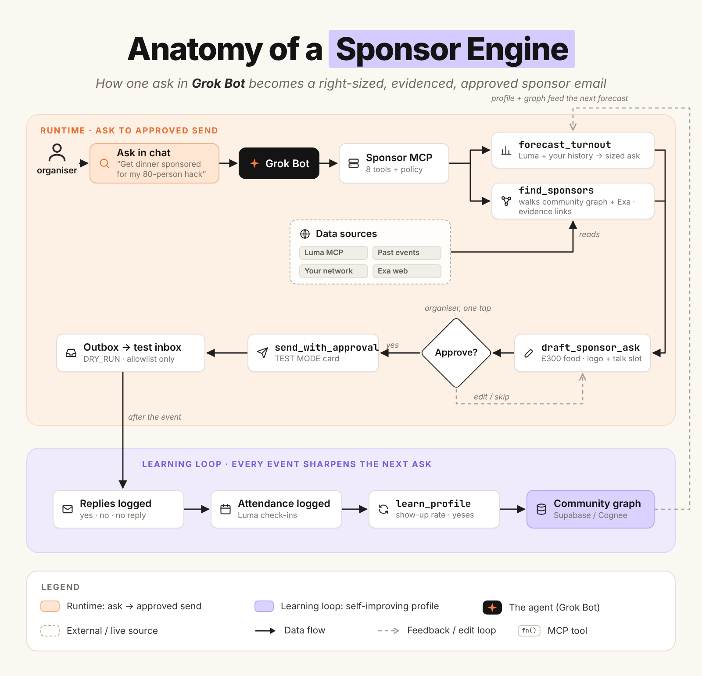
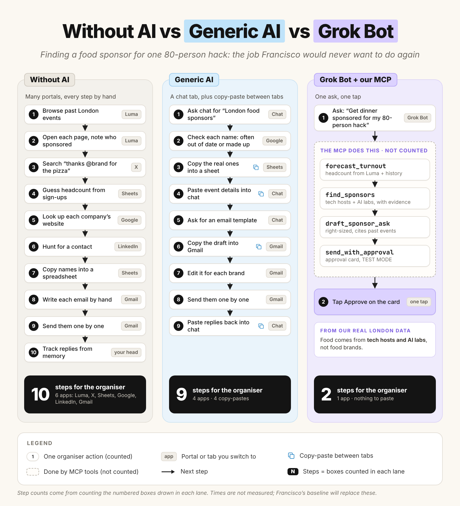
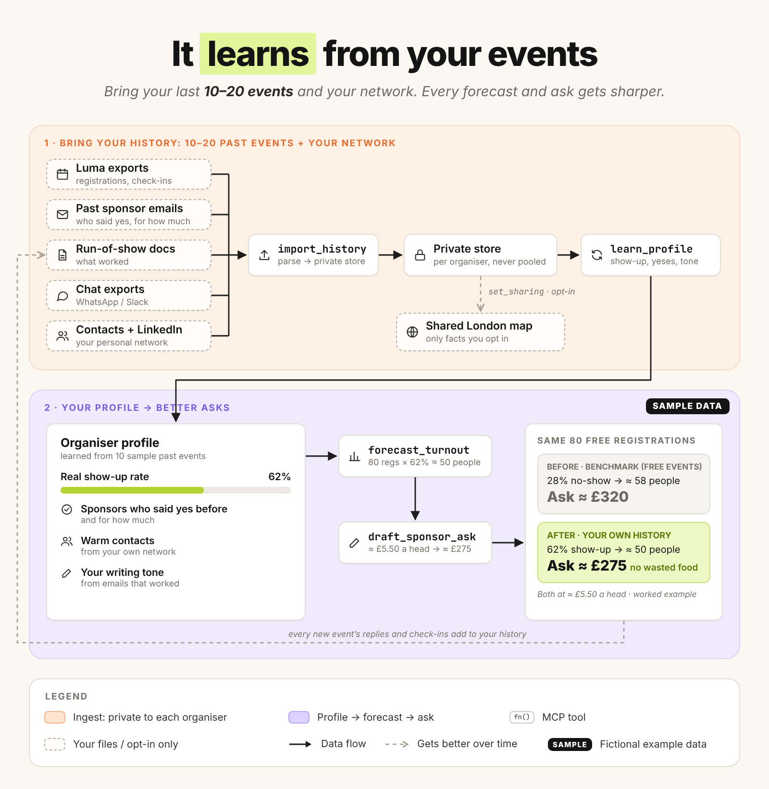
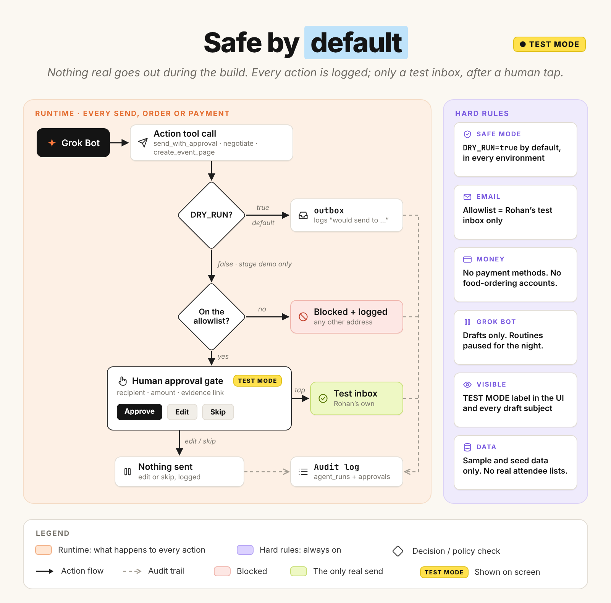

# Sponsor Engine

Sponsor Engine is an open-source front desk and sponsor list for London communities and venues.

You use the web dashboard. You can also call the same tools from Grok Bot or Cursor.

The tools read a booking message, make a quote, match sponsors, and write an email. A person approves the email. The default mode does not send it.

Bring your own tools, or just use ours. The built-in tools need no keys.

## Quick start

You need Node.js 20 or later.

Run this command from the project folder:

```bash
npm install && npm run dev
```

Open `http://localhost:3000`.

The first start loads the bundled data. The inbox is empty until a message arrives. Press **Run demo** on the inbox. That reads one WhatsApp note from Unicorn Mafia about a hackathon at Expedite London. Sponsor drafts use placeholders at `sponsors@example.com`. `DRY_RUN` stays on, so nothing is sent. Thames Agent Builders stays in the sample seed. The room price uses SAMPLE venue history.

Two more commands are useful:

```bash
npm test
npm run demo
```

`npm run dev` builds the pricing package when that build is missing.

`npm test` builds the pricing package. It then runs `tsc --noEmit`. It then runs the pricing tests, the integrations tests, the core tests, and the MCP tests.

## Use it from Grok Bot or Cursor in 2 minutes

Open the MCP settings in Grok Bot or Cursor.

Add this server. Set the working directory to this project folder.

```json
{
  "mcpServers": {
    "sponsor-engine": {
      "command": "npm",
      "args": ["run", "mcp"],
      "env": { "DRY_RUN": "true" }
    }
  }
}
```

MCP means Model Context Protocol. The server name is `sponsor-engine`.

The tools are `triage_inbound`, `quote_booking`, `find_sponsors`, `forecast_turnout`, `draft_sponsor_ask`, `send_with_approval`, `list_failures`, and `recall_history`.

Approve is not a tool. A person approves on the dashboard.

`send_with_approval` does not send a message. It writes a row that waits for a person.

You can also run the HTTP server:

```bash
npm run mcp:http
```

The HTTP server listens on `http://127.0.0.1:8787/mcp`. It uses the same handler as `/api/mcp`. Approve is not a tool.

## Connect

You can keep your own chat app and your own agent. The setup guides are in `docs/connect/`.

## Environment variables

Every variable is optional. You can start with no `.env` file.

Copy `.env.example` to `.env` only when you want to change a value.

| Name | Default | Purpose |
| --- | --- | --- |
| `DRY_RUN` | `true` | Test mode. `true` does not send. |
| `ALLOWLIST` | `sponsors@example.com` | Placeholder test inbox. Sponsor drafts can use `sponsors+name@example.com`. `DRY_RUN` stays true, so nothing is sent. |
| `DATABASE_URL` | empty | Postgres URL. Leave empty to use SQLite. On the hosted site, use the Supavisor transaction pooler URL on port 6543. |
| `DEMO_MODE` | empty | `true` keeps a public site in test mode. |
| `NEXT_PUBLIC_APP_URL` | empty | Public site address. The MCP page uses it. |
| `MCP_TOKEN` | empty | Bearer token for `/api/mcp`. Leave empty on the public demo. |
| `SPONSOR_ENGINE_DB` | `data/sponsor-engine.db` | Path of the SQLite file. |
| `PORT` | `8787` | Port for the local MCP HTTP server. |
| `ZERO_API_KEY` | empty | Optional. Use Zero instead of the built-in list. |
| `TWENTY_API_URL` | empty | Optional. Use Twenty instead of the built-in list. |
| `TWENTY_API_KEY` | empty | Optional. Use with `TWENTY_API_URL`. |
| `COGNEE_API_KEY` | empty | Optional. Use Cognee for memory. |
| `COMPANIES_HOUSE_API_KEY` | empty | Optional. Look up a UK company size. |

Supabase is optional. It is not required. Leave `DATABASE_URL` empty to use SQLite.

The hosted project is `sponsor-engine`. The ref is `rcoxklwwitbuugcndwto`. The region is `eu-west-2`.

Set `DATABASE_URL` to the Supavisor transaction pooler URL. The port is `6543`. The user is `postgres.rcoxklwwitbuugcndwto`. The database is `postgres`. Copy the host from the Connect dialog for transaction mode. The driver is postgres.js with prepared statements turned off, so this URL works in serverless.

Apply `packages/db/src/schema.postgres.sql` in the Supabase SQL editor or through the Supabase MCP. The file is safe to run again. It turns on row level security for every table. `anon` and `authenticated` have no access. The server connection owns the tables, so the app can still read and write. The app also applies this file when it starts.

Run this command after the schema is in place:

```bash
npm run seed:postgres
```

You can run that command again. It adds missing catalog rows. It does not delete messages, quotes, or the outbox.

## Hosted demo

Set the Vercel root directory to `apps/web`.

Set the install command to `npm install --prefix ../..`.

Set the build command to `npm run build --prefix ../.. -w @sponsor-engine/pricing && npm run build --prefix ../.. -w @sponsor-engine/integrations && next build`.

Set `DATABASE_URL` to the Supavisor transaction pooler URL for project `rcoxklwwitbuugcndwto` in `eu-west-2`. The port is `6543`.

Set `DEMO_MODE` to `true`.

Set `NEXT_PUBLIC_APP_URL` to the public site address before the build.

Leave `MCP_TOKEN` empty on the public demo.

Open `/mcp` on the site. The page lists every tool. Each tool has a schema, an example, and a Run button. The page also has copy buttons for Grok Bot, Cursor, Claude, and ChatGPT.

The remote MCP URL is `/api/mcp`. The route is stateless streamable HTTP. It exposes the same tools as the local server. A person approves on the dashboard.

## What you can do in the dashboard

The inbox reads a message and makes a task. The task has an owner and a priority. **Paste a WhatsApp chat** reads a `.txt` export. Nothing is sent.

The quote page shows the room price, the range, and a short explanation.

The room price comes from past bookings. `quote_booking` calls `quotePrice`.

An 80-person community evening can be a free room. The page calls this a community slot.

Food and drinks are a separate cost. The sponsor ask equals that food cost.

The page shows the company room for the same booking beside the community room.

The page shows an Accuracy card. The card calculates the average error on held-out bookings. The numbers are not typed in.

Drop a venue CSV on the Quote page. The app saves the file and runs the check again. The sample file is fictional. Do not treat those prices as a real venue.

The sponsor page ranks London sponsors. Each card shows a company size, a reason, and a source link. With no key, the size comes from the public Companies House page. When that page is off, the bundled note is used.

**To send** holds every message that needs a person. Each one has **Approve**, **Edit**, and **Skip**. Approve stores the deal in the CRM. The built-in CRM is used when no key is set. Approve does not send email.

**Connections** reads `getStatus()`. The built-in CRM and the built-in memory are active with no key. The page also shows the one line that connects Zero, Twenty, Cognee, Luma, Devpost, Companies House, or email.

HubSpot and Sheets are not available yet.

The map shows events on free tiles. No key is required.

## Architecture

The app has five parts.

The data layer stores messages, tasks, bookings, quotes, sponsors, and the outbox.

The pricing package reads a booking history and returns a room price.

The core reads a message, makes a quote, and matches sponsors.

The MCP server exposes those tools to Grok Bot and Cursor.

The dashboard shows the same records to a person.

`packages/pricing` exports `quotePrice(request, history)`. The function returns a price, a currency, a range, an explanation, and comparable bookings. It also exports `loadBookingsFile` for a venue CSV.

The bundled history is a SAMPLE file. A dropped CSV replaces it. The app stores that file at `data/venue-bookings.csv`.

Food is not inside the room price. The core adds a food pass-through. The sponsor email asks for that amount.

`packages/integrations` is optional. When it is present, `find_sponsors` adds a company size to the top matches. Approve calls `pushDeal`. `recall_history` searches with the memory provider. With no key, that search uses the bundled notes. The Connections page calls `getStatus()`. The app runs when that package is absent.

Figure 1 shows the parts of a sponsor engine.



Figure 2 shows the desk without AI, with a generic assistant, and with this tool.



Figure 3 shows how past events feed the next quote.



Figure 4 shows the safety path.



## Safety model

Test mode is the default. `DRY_RUN` is `true`.

The outbox has these states: `draft`, `awaiting_approval`, `needs_contact`, `approved`, `sent`, and `blocked`.

`send_with_approval` does not send. It writes a row with status `awaiting_approval`.

A sponsor email with no public contact uses status `needs_contact`. The recipient stays empty. Find a contact before you approve it.

A person must press **Approve**. That action moves the row to `approved` and stores a CRM draft. The draft does not send email.

In test mode, the row does not move to `sent`.

The row moves to `sent` only when all of these are true:

- The status is `approved`.
- `DRY_RUN` is `false`.
- The recipient is in `ALLOWLIST`.

This repository has no email sender. This repository has no WhatsApp sender.

A test checks that a row cannot reach `sent` before approval.

The dashboard shows a **TEST MODE** badge on every page while test mode is on.

`DEMO_MODE=true` forces test mode. The demo cannot mark a row as sent.

## Data

`data/real-data/` holds public London events and sponsors. Each claim has a quote and a source URL.

`data/synthetic-data/` is fictional. Those rows are marked `SAMPLE`. Do not present them as real companies.

The visual rules are in `docs/DESIGN.md`.

## Licence

MIT. See `LICENSE`.
